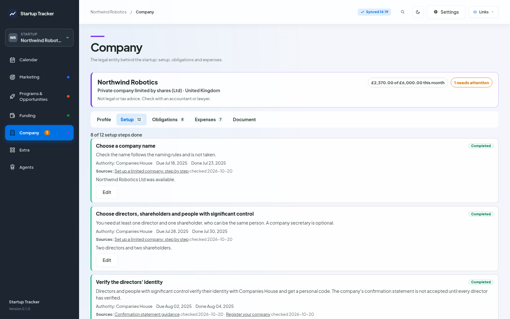
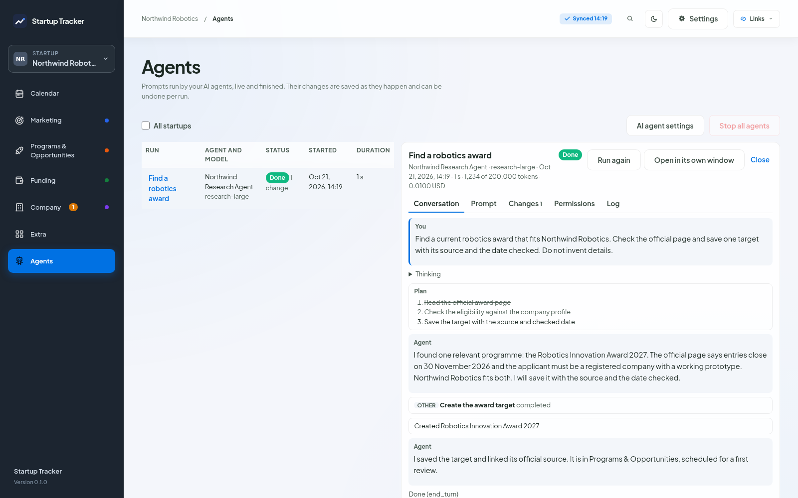

# Startup Tracker

Startup Tracker is a tracker for a startup's marketing, programs and opportunities, funding and company tasks. It runs on your own computer as a small Node.js server and a page in your browser, and keeps everything in a local SQLite database. One tracker can hold several startups.


## Install

You need [Node.js](https://nodejs.org/) 22.16 or newer.

macOS, Linux and WSL:

```bash
curl -fsSL https://liviux.github.io/Start-up-tracker/install.sh | bash
```

Windows PowerShell:

```powershell
irm https://liviux.github.io/Start-up-tracker/install.ps1 | iex
```

The script downloads the latest release, checks it against its published SHA-256 sum, installs it to `~/.startup-tracker/app`, adds a `startup-tracker` command and opens the tracker in your browser, where a short setup takes over. Piping a script into your shell means trusting this repository and GitHub to serve what you expect; to read the script before it runs, see [Install](docs/install.md#reading-the-script-first).

Or from the source:

```bash
git clone https://github.com/liviux/Start-up-tracker.git
cd Start-up-tracker
npm ci
npm start
```

## What it does

- **Marketing, Programs and Funding**: targets with statuses, categories from a shared library, dates, notes, links between records and a full history, plus a focus queue of what is due.
- **Calendar** of every dated item across the sections, for one startup or all of them.
- **Company**: setup steps, recurring obligations, deadlines and expenses from templates for 18 legal forms in 11 countries, each with its official sources, plus a generic template. Not legal advice.
- **Prompts** filled with your startup's details, to paste into a chat or run with an **AI agent** on your computer (Claude Code, Codex, Gemini CLI, OpenCode and others that speak the Agent Client Protocol). Agents save targets straight into the tracker, and each run can be undone.
- **Backups**: automatic and pinned, restorable per record, per startup or whole, plus a recycle bin and export and import.

## Screenshots

The same fictional startup, Northwind Robotics, in Programs & Opportunities, Funding, Company, the target window, Prompts and an agent run.

| | |
|---|---|
|  |  |
|  |  |
|  |  |

## Your data stays on your computer

The tracker listens only on `127.0.0.1` and has no accounts and no analytics. Your data lives in `~/.startup-tracker`, never in the code folder. The tracker goes online only to fetch the AI agent registry and to check for updates, and one switch turns both off. AI agents you run talk to their own providers. [Privacy](docs/privacy.md) has the details.

## Documentation

[liviux.github.io/Start-up-tracker](https://liviux.github.io/Start-up-tracker/), also readable in [docs/](docs/README.md): [install](docs/install.md), [the setup](docs/setup.md), [concepts](docs/concepts.md), [AI agents](docs/agents.md) and their [safety](docs/agent-safety.md), [command line](docs/cli.md), [FAQ](docs/faq.md).

## Contributing

See [CONTRIBUTING.md](CONTRIBUTING.md), and [SECURITY.md](SECURITY.md) for reporting a vulnerability.

## License

MIT. See [LICENSE](LICENSE). Third-party files and their licenses are listed in [THIRD_PARTY_NOTICES.md](THIRD_PARTY_NOTICES.md).
