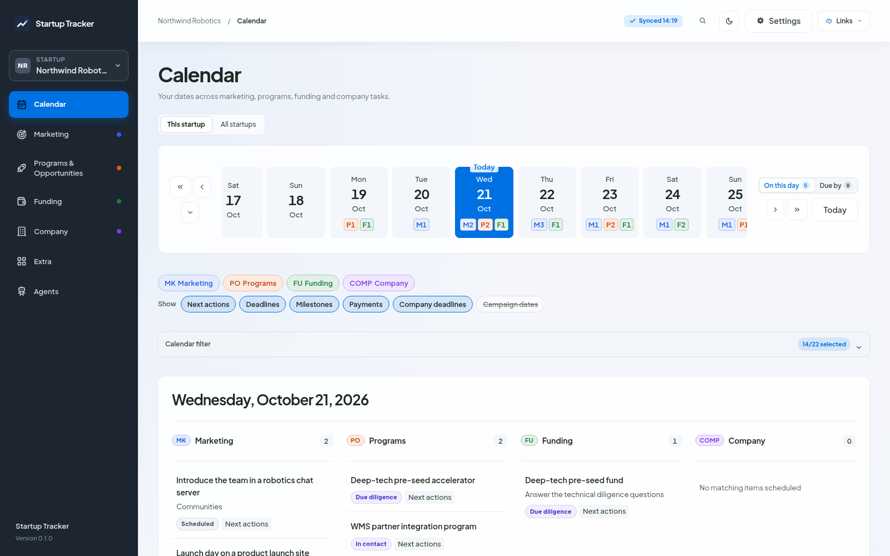

# Calendar

The calendar shows the dated moments of your records: marketing target dates, program next actions, deadlines and milestones, funding next actions, expected closes, payments and commitments, Company deadlines, and, if you turn them on, campaign start and end dates.

*The day strip, then the events of the chosen day, grouped by section. The letters count events per section.*

## The day strip

Nine days around the chosen one. Each day shows one count per section, as the section's letter and number in its colour: `M2 P4 F1 C1` means two marketing events, four program events, one funding event and one Company event. Sections without events that day are left out. Hover a count to see it split by status group; screen readers hear the section names and counts.

**On this day** lists the events of the chosen day. **Due by** lists, per record, its next date on or before the chosen day, so you see everything that is due or overdue.

## The month

The arrow under the day strip opens the month: whole weeks from the one holding the 1st to the one holding the last day, five or six rows, starting on the day set in Settings > General. **Previous month** and **Next month** move a month at a time, and the title shows the month's counts per section. Click a day to pick it.

## Filters

- **This startup / All startups**: with all startups, each event shows its startup, and the counts and the summary cover every startup that is not archived.
- **Sections**: MK, PO, FU and COMP turn a section on or off everywhere in the calendar.
- **Show**: next actions, deadlines, milestones, payments, Company deadlines and campaign dates. Campaign dates are off until you turn them on.
- **Status filter**: the same filter as the focus queues (see [Statuses](statuses.md)). The statuses are the same in every section, so one filter covers them all: for example only Scheduled and Preparing, or only part of Done.

The filters are remembered per startup.

## Opening an event

Clicking an event opens the record in its window on top of the calendar. **Show in list** in the window's header takes you to the record in its own section. Company entries open in the Company section, with the part that holds them expanded.

## Total items summary

One row per section, with the items per status group (Planned, In progress, Done, Closed, and Unmapped when some status is not in the list), the item total and the event count. One program with three dates is one item and three events.

- **Visible days** counts the records with a date in the days on screen (the nine days, or the month when it is open).
- **All time** counts every record, with or without a date.

The summary follows the section toggles, the event types and the status filter. Click a section's item total to hide or show that section.
