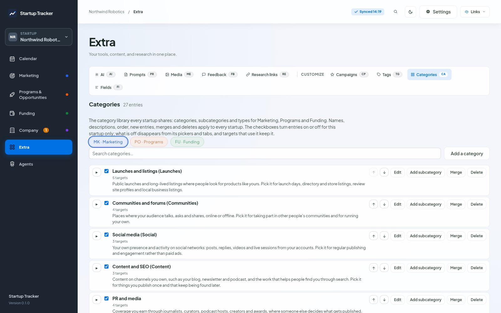

# Categories

Marketing, Programs and Funding share one category library with three levels: **category**, **subcategory** and **type**. The same three words mean the same thing in all three sections. Every entry has a short description that says what it is and when to pick it; you see it as a tooltip on tabs and pills, and in the picker.

The library ships in `content/taxonomy/` (`mk.json`, `po.json`, `fu.json`). It is written to fit any startup in any country and industry, and it names no brands; brands appear only as examples inside descriptions.

*Extra > Categories. The checkbox turns an entry on or off for the startup you are in; the counts show how many targets use it.*

## A target's categories

A target can sit in several places at once: a write-up of your product design can be both a blog article and a forum post. Pick as many entries as fit, from the target's own section. The first one is the **primary**: it is shown first and decides the target's place in sorted lists. "Make primary" moves another one to the front.

Picking a type also records its subcategory and category, so a filter on the category finds it.

A target shows under every category tab one of its entries falls in. That is why the counts on the category tabs can add up to more than **All**, which counts each target once.

## Turning entries off for one startup

Not every startup needs every entry. In **Extra > Categories**, the checkbox next to an entry turns it on or off for the startup you are in. An entry that is off disappears from that startup's tabs and pickers; turning off a category turns off everything under it, and turning on a type turns its parents back on. Other startups are not affected.

Targets that already use an entry you turned off keep it, marked "turned off". A target whose category is not in the library at all, for example after an import, keeps it too, marked "not in the library".

To give a new startup the same choice as an existing one, use **Copy settings from another startup** in Settings > Startups.

## Editing the library

**Extra > Categories** has a tab for each section, a search box and the tree. Changes here apply to every startup:

- **Edit** a name, short name (categories only, shown on the tabs) or description. Descriptions are required and can be up to 400 characters.
- **Add** a category, or a subcategory or type under an entry.
- **↑ / ↓** change the order.
- **Merge** an entry into another one of the same level. Every target that used it, in every startup, moves to the other entry, and what was under it moves along.
- **Delete** an entry and everything under it. If targets use it, you choose where they move first; the move happens in every startup, recycle bins included.
- **Reset to library text** puts a built-in entry's name and description back.

## Library updates

The library has a version number. When a newer release adds entries, Extra > Categories lists them under "New entries in the library". Tick the ones you want and add them; the others are skipped and not offered again. Nothing is added without you choosing it.

## Sharing a library

**Export the library** downloads it as a JSON file. **Import a library** adds the entries from such a file that this tracker does not have yet, marked as added here. Entries you already have are left alone.
