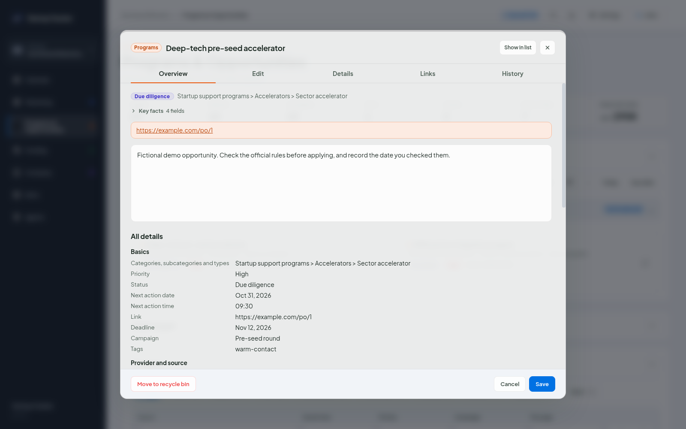

# The target window and fields

Every target in Marketing, Programs and Funding opens in the same window, with the same five tabs across its full width:

| Tab | What it holds |
|---|---|
| Overview | The status and the primary category, then "Key facts", folded until you open it (once open, it opens that way on every target in this browser until you fold it again): priority, next action, deadline, organization, owner and campaign in one row (a long value shows five lines and scrolls inside its box). Then the target's link, the notes as you wrote them, and "All details": every filled field by group, the timeline, your custom fields, the links and when the target last changed. |
| Edit | The notes in Markdown, with a live preview next to them. Both grow with the text, so only the window scrolls. |
| Details | The basics first, then the section's fields in groups, then the timeline, commitments and payments (Funding), and last the target's custom fields. |
| Links | Every link to other records (see [Links](links.md)), and buttons to create a linked target in Marketing, Programs or Funding. |
| History | Every change to the target, with "Restore this value" on each field. |

*The target window: status and dates, and every filled field by group under "All details".*

Changes stay in the window until you press **Save**. **Cancel**, **Esc** or the close button ask before dropping them, in the app's own dialog. **Enter** in a one-line box saves. **Move to recycle bin** deletes the target; you can restore it from Settings > Recycle bin.

## Fields

Every field has a short help text under it and, where it helps, an example inside the box. Examples are faint, slanted and start with "e.g.": they are never saved. Some fields offer a suggested value, such as your startup's currency; it is saved only when you press **Use**.

In number fields an empty box means "not known" and 0 is a real zero, so the two never mix in totals.

The basics are the same in every section: ID (with a copy button), name, categories, priority, status, next action date and time, organization, link, next action, deadline, owner, campaign, tags and repeat. Funding also has the funding round. The categories stay folded to what you picked until you open them.

In Details, the name of every field that holds a value sits on a light wash of the section's colour, so you can see at a glance what is filled in.

The section fields are listed in `content/fields/` (`common.json`, `mk.json`, `po.json`, `fu.json`), each with its help text, example and choices. About 30 for Marketing (audience, rules, results, effort, contact, timing, learning), 41 for Programs (provider, eligibility, value and costs, application) and 31 for Funding (funder, contact, ask and terms, process).

## The timeline

One dated list per target holds both what is coming and what happened:

- **Add key date** records a date that matters ahead, such as an info session, a demo day or a decision. Key dates show on the calendar as milestones.
- **Log update** records what happened: research, a message sent, a follow-up, a reply, a call, something published, a decision. An update can give the status after it and the next action with its date; saving it moves the target on to those.

The list shows the latest date first. Updates also appear in the History tab, among the field changes.

## Custom fields

The last group in Details holds the target's own labels and values, as many as you need: a login, a reference number, a figure no field covers. **Add field** adds a row; **×** removes one. They belong to this target only, and the search box of each section reads them.
