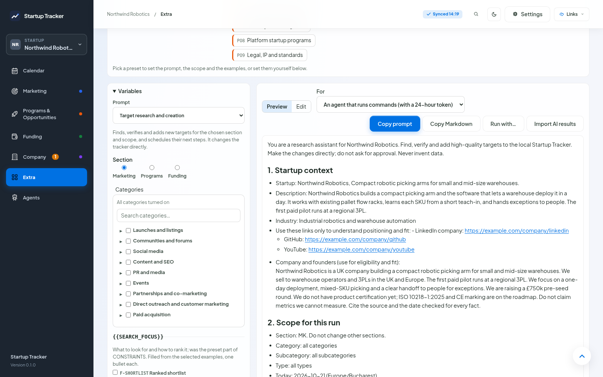

# Prompts

Extra > Prompts builds the prompt you give an AI agent or chat to find and add targets. It fills in your startup's details, the scope you pick and the instructions you choose, so the same prompt works for every startup.

*The variables panel and the prompt preview. The startup context comes from Settings > Startup profile and the AI context text.*

## Presets

The presets sit at the top of the page, grouped by section: Marketing, Programs, Funding and General. Each says what it does and when to use it (hover or focus it to read both). Picking one sets the prompt, the section, the categories and the examples. You can change any of them before you copy.

A preset whose categories are all turned off for this startup is hidden. **Show all** brings them back.

The app ships 21 presets, for example "Events: conferences in the next 6 months", "Launches and listings", "Angels and early-stage funds", "Weekly review" (re-checks the targets already in the tracker) and "Research a topic" (type the topic in the variables before you copy). **Save as preset** keeps your own choices as a new preset, shared by all your startups.

## Variables

The variables panel is open on the left. Only double braces are variables: `{{STARTUP_NAME}}` is filled in, `{section}` in a web address is left alone.

| Filled from | Variables |
|---|---|
| Settings > Startup profile | `{{STARTUP_NAME}}`, `{{STARTUP_ONE_LINER}}`, `{{STARTUP_DESCRIPTION}}`, `{{STARTUP_WEBSITE}}`, `{{STARTUP_LINKS}}`, `{{SECTOR}}` (the industry), `{{CONSTRAINTS}}` (company and founders), `{{COUNTRY}}`, `{{ENTITY_TYPE}}`, `{{HOME_REGION}}`, `{{MAX_TARGETS_PER_DAY}}` |
| Settings > General | `{{TODAY}}`, `{{TIMEZONE}}` |
| The section and categories you pick | `{{TAB}}`, `{{CATEGORY}}`, `{{SUBCATEGORY}}`, `{{TYPE}}`, `{{SCOPE_DETAILS}}` (the descriptions of what you picked) |
| The examples you tick | `{{SEARCH_FOCUS}}`, `{{VERIFIED_ACTIVITY}}`, `{{AVOID}}`, `{{SPECIAL_SCHEDULE}}` |
| How the prompt is copied | `{{TRACKER_ACCESS}}` |

Each ticked example becomes one bullet. "More for this run" adds a bullet for this copy only; **Save this text as an example** keeps it in the library for every startup. Examples can mention variables too, such as `{{SECTOR}}`; they are filled in the same way.

A variable with no value takes its line with it, and a block such as `{{CONSTRAINTS}}` or `{{SEARCH_FOCUS}}` also takes the heading line above it. The panel lists the profile values the prompt uses and marks the empty ones; fill them in Settings > Startup profile.

## Copying

Pick who the prompt is for:

- **An agent that runs commands** (Claude Code, Codex and the like). `{{TRACKER_ACCESS}}` explains how to read and write the tracker over its local API. **Copy prompt** makes a new token for this startup at that moment and puts it in the prompt. The token can add and update targets of this startup and link records, nothing else, and stops working after 24 hours. The master token in `secrets/api-token` is never put in a prompt.
- **A chat without tools.** The prompt asks for the targets as a JSON block at the end of the reply.

**Run with…** sends the prompt to one of your AI agents instead of copying it, and shows the run as it goes. There `{{TRACKER_ACCESS}}` points the agent to the tracker tools of the run, with no token in the text. See [AI agents](agents.md).

**Copy prompt** copies plain text; **Copy Markdown** keeps the Markdown. The page warns when something is left unfilled.

## Import AI results

Paste a chat's reply into **Import AI results** and select **Check**. Each target is checked against the fields of its section: unknown fields, dates that are not dates and links that are not web addresses are left out and listed. Targets with the same link or name as one you already track, or as one earlier in the reply, are marked as likely duplicates and start unticked. **Add** adds the ticked ones at the top of their section.

## Your own prompts

The app ships two prompts: "Target research and creation" and "Outreach and strategy plan" (which reads the tracker and changes nothing). **Edit** changes the prompt for all your startups; for a built-in prompt this saves your version, and **Reset built-in prompt to latest** goes back to the shipped one. **New prompt** starts a copy of the current one. Deleting your own prompt moves it to the recycle bin.

**Export prompt pack** saves your prompts, presets and examples as a JSON file; **Import prompt pack** adds them to another install. Entries with an id you already have replace yours after you confirm.

## Company and founders

`{{CONSTRAINTS}}` is the text in Settings > Startup profile > "Company and founders, for AI prompts". Each startup has its own. The editor counts characters (aim for about 1,000) and lists the topics that help an agent judge fit, such as the legal entity, the founders, what you may apply for and your deal-breakers; select a topic to add a sentence to start from.

## Tokens

Each copy for an agent makes a token that ends after 24 hours. `GET /api/agent-tokens` lists them and `POST /api/agent-tokens/<id>/revoke` ends one at once (see [HTTP API](api.md)).
