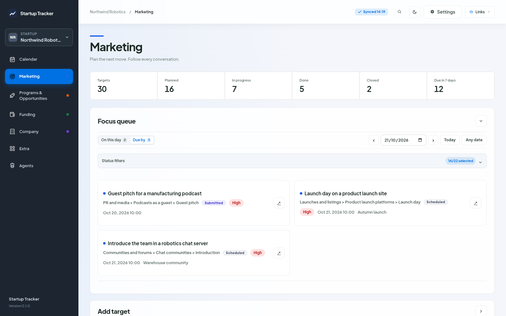
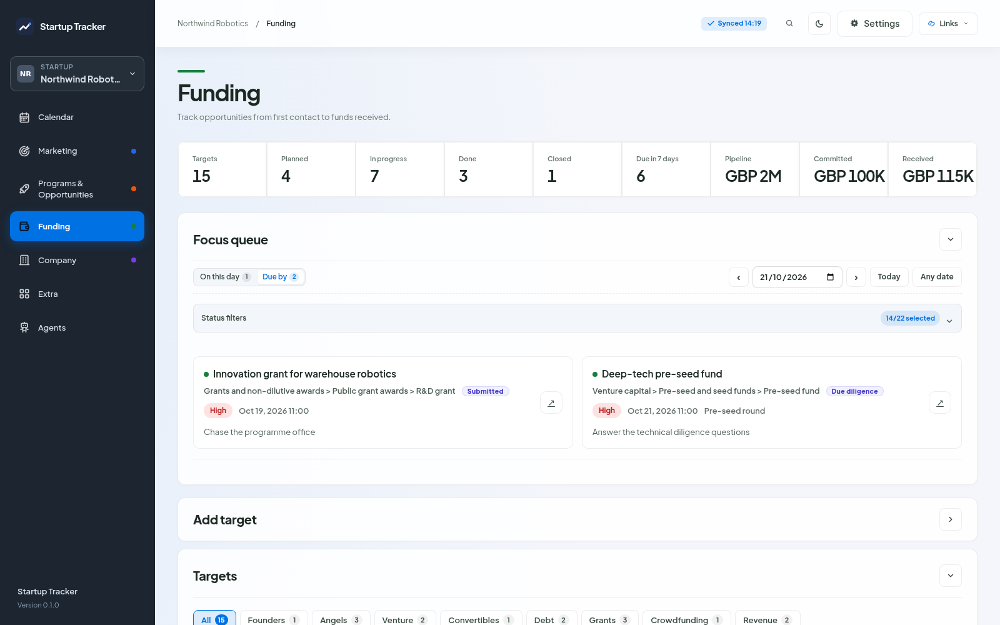
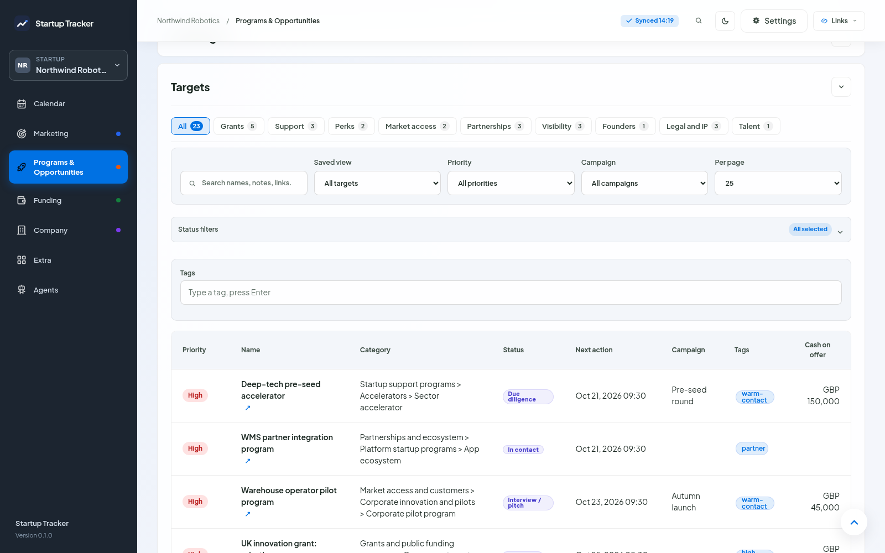

# Marketing, Programs and Funding pages

The three section pages work the same way and use the same names.

## Header

The section name in its colour, a one-line description and the numbers: how many targets there are, how many sit in each status group (Planned, In progress, Done, Closed) and how many are due in the next 7 days. Funding adds the pipeline (what open deals ask for), what is committed and what was received. Programs adds the expected value: the cash on offer in open applications, times their probability when you set one.

*The Marketing page of the demo startup. The focus queue starts with what is due today or overdue.*

*Funding adds the money columns and keeps its open deals in the focus queue.*

## Focus queue

The targets with a next action date. **On this day** shows the ones dated on the chosen day, **Due by** the ones dated on or before it; the numbers on the two buttons count both. Use the arrows, **Today** or **Any date** to move. The status filter starts with Planned and In progress, so Done and Closed stay out of the way. Click a card to open the target.

## Add target

The same fields everywhere: name, organization, link, categories, status (New), priority (Medium), next action, its date and time, campaign and tags. **Add target** adds it and empties the form. **Add and open details** opens the new target in the target window first, where every other field is; it is added when you press **Add target** there.

## Targets

A read-only table with the same columns in every section: priority, name and organization, category (the primary one, with "+N" when there are more), status, next action, campaign and tags. Programs add the cash on offer and Funding the ask. Click a row, or its name, to open the target; a link in the row opens that link instead. Column headers sort.

*Programs & Opportunities: the category tabs count targets, and the table shows the cash on offer.*

Filters:

- the category tabs above the table, and a search box that reads names, organizations, links, notes, next actions, owners, tags, links to other records and your own fields;
- saved views: All targets, Overdue, Due this week, Due this month, Waiting for an answer, No next action, High and very high, No campaign;
- priority, campaign, status (the same status filter as the Focus queue), tags and your own fields (Extra > Fields);
- rows per page, which starts at the size set in Settings > General until you pick one here.

Funding keeps its **Funding rounds** below the targets.

The filters each page shows are remembered in this browser, per startup.
