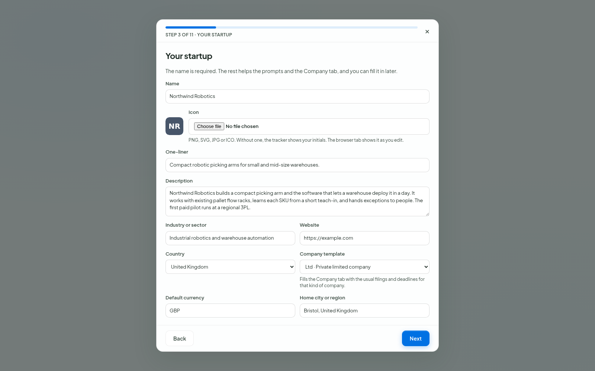

# The setup

The first time you open the tracker with an empty data folder, a setup opens in the browser. It asks for what the app needs, one step at a time. Each step is saved when you leave it, so you can close the setup or reload the page and pick up at the same step later, in any tab.

Only two things are required: the startup's name and your time zone. Every other step has **Skip**, and everything the setup asks for can be changed later in **Settings**.

*The "Your startup" step. The country suggests a currency and puts that country's company templates first.*

## The steps

The setup has eleven screens. The three "What to track" pages are grouped under step 6 here.

1. **Welcome**: what the tracker does, and that your data stays on this computer.
2. **Basics**, shared by every startup: time zone (the one your browser reports is filled in; confirm it or pick another), date format, theme, light or dark, and language (English for now).
3. **Your startup**: name, icon, one-liner, description, industry, website, country, company template, the state or province when the template asks for one, default currency and home city or region. While you type the name or pick an icon, the browser tab shows them the way they will look. Picking a country suggests its currency and puts that country's company templates first; you can also pick the Generic template or "Not incorporated yet". See [Company](company.md).
4. **Links**: your website, profiles and pages. Paste an address and its type is picked for you (GitHub, LinkedIn, Product Hunt and so on), or pick it yourself. Reorder with the arrows. The links show in the **Links** menu at the top of the page, each with its icon, and fill `{{STARTUP_LINKS}}` in prompts.
5. **AI context**: the "Company and founders" text every prompt carries (`{{CONSTRAINTS}}`), with the same topic buttons as in Settings. See [Prompts](prompts.md).
6. **What to track**: one page each for Marketing, Programs and Funding. Tick the categories that matter to you; the ones the library marks **Recommended** are ticked already. Each page has a search box, **All** and **None** for every branch and a counter. **Skip** puts that section back to the Recommended categories. **Turn everything on** is there too, after a note that picking takes 10 to 20 minutes and that fewer categories mean less noise. You can change all of it later in **Extra > Categories**. See [Categories](categories.md).
7. **AI agents** (optional): the agents found on this computer, with Add and Check, and the default model. The same as **Settings > AI agents**. See [AI agents](agents.md).
8. **Backups**: whether automatic backups run, how many to keep (20 by default) and where your data folder is. See [Backups](backups.md).
9. **Done**: what you skipped, and three ways on: **Open the tracker**, **Add another startup** (steps 3 to 6 again) or **Add a demo startup to explore**.

## Finishing later

If you close the setup before **Done**, a **Finish setup** badge stays in the sidebar. Click it to continue where you stopped. It goes away once you reach **Done**.

A tracker that already had startups before the setup existed counts as set up, so nobody is sent through it again.

## The demo startup

**Add a demo startup to explore** adds a fictional startup, "Northwind Robotics", with a full marketing pipeline, program and funding targets, two funding rounds, linked records, feedback, research links, media records, and a UK Ltd company profile with setup steps, obligations and expenses, plus three shared campaigns. It is there so you can see how the pages look with data in them. **Delete the demo startup** on the same page removes it and its three campaigns in one click, after the usual safety backup. Nothing of yours is touched.

## Adding another startup

**Settings > Startups > Start the setup for a new startup** runs steps 3 to 6 for a new startup. The quick form below it still adds a startup by name, optionally copying another startup's settings. See [Startups](startups.md).

## Running it again

**Settings > About > Run setup again** opens the setup from the start for the startup you have open. Each step starts from what is saved, so nothing is lost by walking through it.
